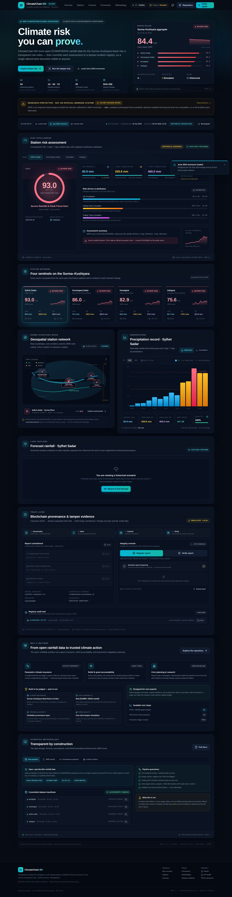

# ClimateChain BD 🌊⛓️

### Climate risk you can prove.

**Transparent rainfall-risk intelligence with independently verifiable blockchain provenance**
for the Surma–Kushiyara basin, Sylhet Division, Bangladesh.

[](https://github.com/ragibcs/climatechain-bd)
[](https://www.python.org/)
[](https://nextjs.org/)
[](https://soliditylang.org/)
[](#verification)
[](LICENSE)

> [!IMPORTANT]
> **Research prototype — not an official flood-warning system.** ClimateChain BD was built
> for the IEEE ClimateChain Global Hackathon. Machine-readable daily flood ground truth and
> real-time BWDB gauge APIs were unavailable as open REST services, so we implement a
> transparent **rainfall-risk indicator** rather than fabricating flood labels or hydrology.
> Always consult the [FFWC](https://ffwc.gov.bd/) and BMD for life-safety advisories.



<p align="center"><em>June 2024 monsoon replay: four stations escalate to SEVERE, with live SHA-256 manifest checks and a one-click tamper test.</em></p>

---

## 1. Why this project exists

Monsoon cloudbursts over the Meghalaya plateau send rapid transboundary runoff into the
low-lying haor wetlands of Sylhet, Sunamganj, Kanaighat, and Zakiganj. Relief agencies,
parametric insurers, and civic planners face two trust failures at once:

1. **Uncalibrated claims** — black-box models trained on fabricated flood masks.
2. **Mutable evidence** — impact reports that can be silently edited after a payout or
   grant decision.

ClimateChain BD separates the two problems and solves them independently:

| Layer | What it does | Why it matters |
| --- | --- | --- |
| **Open rainfall data** | ECMWF/ERA5 daily precipitation via Open-Meteo for four stations | The input is open, timestamped, and reproducible |
| **Transparent risk** | Sylhet Rainfall Risk Index (SRRI) with 1d/3d/7d weights and BMD thresholds | No black box and no invented flood probabilities |
| **Verifiable evidence** | Canonical JSON → domain-separated SHA-256 → EVM commitment | Anyone can recompute the hash and detect tampering |
| **Honest failure** | `UNAVAILABLE` / `NOT_FOUND` / `PENDING` states | The system never returns a false `VERIFIED` |

---

## 2. Feature highlights

### Climate intelligence
- **Four-station basin overview** with real coordinates, rivers, BWDB IDs, and danger levels.
- **Animated SRRI gauge** with weighted factor attribution and plain-language interpretation.
- **Scenario engine**: latest available data, 19 June 2024 monsoon replay, or any custom historical date.
- **Observation explorer**: daily rainfall bars or cumulative 3-day/7-day lines, BMD heavy/very-heavy thresholds, 7/14/30-day windows, and quality stats.
- **Seven-day forecast** with precipitation probability, temperature, and a separately labelled forecast outlook.
- **Basin map** with risk-coded markers, hover detail, river corridors, and haor context.

### Trust and provenance
- **Canonical JSON** with sorted keys, normalized floats, and compact UTF-8 serialization.
- **Domain-separated hashing** for data batches, prediction reports, and report IDs.
- **Solidity registry** (`ClimateProvenance.sol`) with duplicate/zero-hash rejection and events.
- **Three tamper modes** in the UI: alter the score, alter rainfall metrics, or rewrite the summary.
- **Hash comparison** shows computed vs stored commitments line-by-line.
- **Registry audit trail**, JSON export, and copy-to-clipboard receipts.
- **Sepolia RPC support** with a deterministic local simulator when no signer is configured; mode labels distinguish on-chain, read-only RPC, and simulated records.

### Data integrity
- **Committed sample snapshots** with SHA-256 manifests.
- **Runtime integrity endpoint** (`GET /api/datasets`) recomputes each manifest hash and reports `4/4` when intact.
- **Past-only feature windows** with a dedicated test to prove no future leakage.
- **Nullable river levels and flood labels** — missing values are never replaced with invented numbers.

### Engineering polish
- Responsive dark dashboard with accessible focus states and reduced-motion support.
- Skeleton loaders, toast feedback, explicit `DEGRADED_OFFLINE_CACHE` fallback, and a persistent prototype disclosure.
- FastAPI TTL caches + concurrent station fetches keep demo loads snappy.
- Docker, Docker Compose, Render blueprint, Makefile, CI, and one-command test suite.

---

## 3. Quickstart

### Prerequisites
- Python 3.10+ (tested on 3.14)
- Node.js 18+ (tested on Node 20/26)
- npm 9+

### Option A — Makefile

```bash
git clone https://github.com/ragibcs/climatechain-bd.git
cd climatechain-bd

make install       # Python venv + contracts + web dependencies
make seed-data     # ingest committed June 2024 monsoon snapshots
make test          # 22 Python + 10 Hardhat tests
make run-api       # FastAPI  → http://localhost:8000/docs
make run-web       # Next.js  → http://localhost:3000
```

### Option B — Docker Compose

```bash
docker compose up --build
```

- Dashboard: [http://localhost:3000](http://localhost:3000)
- API docs: [http://localhost:8000/docs](http://localhost:8000/docs)

### Option C — Render blueprint

1. Push/fork the repo to GitHub.
2. In Render: **New + → Blueprint**, select the repository.
3. Render detects [`render.yaml`](render.yaml), builds the unified [`Dockerfile`](Dockerfile),
   and starts both FastAPI and Next.js in one container.
4. Optional provenance secrets: `RPC_URL`, `CONTRACT_ADDRESS`, `DEPLOYER_PRIVATE_KEY`.
   The app works in labelled simulator mode without them.

---

## 4. Architecture

```text
Browser
  │
  ├─ Next.js 14 App Router (hero, station cards, map, charts, provenance console)
  │    └─ /api/* rewrite → FastAPI
  │
  └─ FastAPI
       ├─ Open-Meteo ECMWF/ERA5 (TTL cache, 4 stations)
       ├─ Past-only SRRI engine + basin overview + forecast outlook
       ├─ Committed samples + SHA-256 manifests
       └─ Canonical JSON → SEPOLIA RPC → ClimateProvenance.sol
```

```text
climatechain-bd/
├── apps/web/                     # Next.js 14 + TypeScript + Tailwind
│   └── src/
│       ├── app/                  # layout, globals, page orchestration
│       ├── components/           # hero, scenario bar, risk, map, charts, provenance, methodology
│       └── lib/                  # types, risk theme/format helpers, offline fallback
├── services/api/
│   ├── main.py                   # REST API, caching, validation
│   └── provenance/               # canonical hashing, Web3 client, contract ABI
├── ml/
│   ├── data/                     # station metadata, Open-Meteo ingestion, seed script
│   ├── features.py               # SRRI formula + past-only rolling windows
│   └── inference.py              # reports, basin overview, forecast outlook
├── contracts/                    # ClimateProvenance.sol + Hardhat tests
├── data/                         # committed samples + SHA-256 manifests
├── docs/                         # architecture, model card, threat model, demo, playbook
├── tests/                        # 22 API / data / risk / provenance tests
├── Dockerfile, docker-compose.yml, render.yaml, Makefile
```

Deeper detail: [`docs/architecture.md`](docs/architecture.md) ·
[`docs/implementation-plan.md`](docs/implementation-plan.md) ·
[`docs/hackathon-playbook.md`](docs/hackathon-playbook.md).

---

## 5. API surface

| Method | Endpoint | Description |
| --- | --- | --- |
| `GET` | `/api/health` | Service, uptime, provenance mode, dependency status |
| `GET` | `/api/locations` | Four station metadata records |
| `GET` | `/api/overview?as_of=&live=` | Basin aggregate + all-station risk snapshots |
| `GET` | `/api/observations?location_id=&start_date=&end_date=&limit=` | Live or historical rainfall window |
| `GET` | `/api/risk?location_id=&as_of=` | Full SRRI report for one station |
| `POST` | `/api/predictions` | Structured prediction report |
| `GET` | `/api/forecast?location_id=&days=` | 7-day precipitation + forecast outlook |
| `GET` | `/api/datasets` | Manifest metadata + live SHA-256 integrity check |
| `POST` | `/api/provenance/register` | Commit a report on-chain or to the simulator |
| `GET` | `/api/provenance/registry` | Audit trail of commitments |
| `GET` | `/api/provenance/{report_id}` | Look up a single commitment |
| `POST` | `/api/provenance/verify` | Five-state integrity verdict |
| `POST` | `/api/cache/clear` | Clear climate/overview caches |

---

## 6. The SRRI model

```text
SRRI = 0.50 · min(100, R₁d / 100  · 100)
     + 0.30 · min(100, R₃d / 200  · 100)
     + 0.20 · min(100, R₇d / 350  · 100)
```

- **24h rainfall (50%)** — acute cloudburst / flash-flood potential. BMD heavy >44 mm,
  very heavy >88 mm.
- **3-day cumulative (30%)** — Surma catchment inflow and urban drainage congestion.
- **7-day cumulative (20%)** — antecedent haor saturation and wetland storage fill.

| Score | Level | Interpretation |
| --- | --- | --- |
| 0–24 | **LOW** | Minimal hydrological stress |
| 25–49 | **MODERATE** | Localized waterlogging possible |
| 50–74 | **HIGH** | Significant overflow risk |
| 75–100 | **SEVERE** | Extreme deluge indicator |

Rolling windows are **strictly past-only**; a test asserts that no future record can leak
into a score. The model is a meteorological indicator, **not** a calibrated flood
probability. See [`docs/model-card.md`](docs/model-card.md).

---

## 7. Provenance flow

```text
Report JSON
   │  canonicalize: sorted keys, normalized floats, compact UTF-8
   ▼
Domain-separated SHA-256
   ├─ CLIMATECHAIN_BD_PREDICTION_REPORT_V1:
   └─ CLIMATECHAIN_BD_DATA_BATCH_V1:
   ▼
bytes32 reportId / reportHash / dataHash
   ▼
ClimateProvenance.sol  (Sepolia when a signer is configured;
                        labelled local simulator otherwise)
   ▼
verify: recompute locally → compare to stored commitment
   ├─ VERIFIED     byte-for-byte match
   ├─ MISMATCH     tampering detected
   ├─ NOT_FOUND    no commitment exists
   ├─ UNAVAILABLE  RPC down; refuses to guess
   └─ PENDING      transaction awaiting confirmation
```

> A blockchain hash proves **byte-level consistency with a commitment**. It does not prove
> that the source data is truthful or that the science is correct — and the UI says so.

---

## 8. Verification

```bash
make test
```

Actual results from this repository:

| Suite | Command | Result |
| --- | --- | --- |
| Python API / data / risk / provenance | `PYTHONPATH=. .venv/bin/pytest tests/ -v` | **22 passed** |
| Solidity contract | `cd contracts && npx hardhat test` | **10 passed** |
| Frontend type-check | `cd apps/web && npx tsc --noEmit` | **0 errors** |
| Frontend production build | `cd apps/web && npm run build` | **Compiled successfully** |

Coverage includes: rolling-window correctness and no-future-leakage, risk schema and
limits, canonical hashing determinism, duplicate/zero-hash rejection, full provenance
lifecycle, tamper detection, RPC outage handling, latest/historical overview, forecast
contract, dataset integrity, explicit offline-fallback labelling, and input validation.

---

## 9. Deployment notes

The unified [`Dockerfile`](Dockerfile) builds the Next.js app, installs Python
dependencies, starts FastAPI on an internal port, and runs Next.js on the public port.
[`render.yaml`](render.yaml) configures the same image for Render.

Optional environment variables (see [`.env.example`](.env.example)):

```bash
OPEN_METEO_BASE_URL=https://archive-api.open-meteo.com/v1/archive
OPEN_METEO_FORECAST_URL=https://api.open-meteo.com/v1/forecast
OPEN_METEO_CACHE_TTL=600
OVERVIEW_CACHE_TTL=300

CHAIN_ID=11155111
RPC_URL=https://rpc.sepolia.org
CONTRACT_ADDRESS=
DEPLOYER_PRIVATE_KEY=

FRONTEND_ORIGIN=http://localhost:3000
ALLOW_ALL_ORIGINS=false
```

The API also accepts `ETH_RPC_URL` / `SEPOLIA_RPC_URL` and `SIGNER_PRIVATE_KEY` aliases for
hosted platforms. Never expose a private key to the browser.

---

## 10. Documentation

| Document | Contents |
| --- | --- |
| [`docs/architecture.md`](docs/architecture.md) | System diagram, request lifecycle, deployment topology |
| [`docs/implementation-plan.md`](docs/implementation-plan.md) | Status, judging alignment, demo runbook, risks, roadmap |
| [`docs/hackathon-playbook.md`](docs/hackathon-playbook.md) | 30-second pitch, slide outline, judge Q&A, submission checklist |
| [`docs/demo-script.md`](docs/demo-script.md) | Word-for-word 4-minute demo |
| [`docs/model-card.md`](docs/model-card.md) | SRRI formula, calibration, limitations |
| [`docs/data-sources.md`](docs/data-sources.md) | Open-Meteo/ERA5 variables, coverage, licensing |
| [`docs/data-feasibility.md`](docs/data-feasibility.md) | Why no fabricated flood labels |
| [`docs/threat-model.md`](docs/threat-model.md) | Adversaries, failure modes, mitigations |
| [`docs/smart-contract.md`](docs/smart-contract.md) | Contract interface and invariants |

---

## 11. Roadmap

- [ ] FFWC / BWDB gauge adapter behind a feature flag (only with a verified source).
- [ ] IPFS-pinned full report payloads with CID as `metadataUri`.
- [ ] Signed ingestion manifests / data-source attestations.
- [ ] Playwright end-to-end test for the tamper flow.
- [ ] Chronological SRRI evaluation if verified flood labels become available.
- [ ] Parametric trigger contract with oracle / attestation separation.

---

## 12. Author & licence

**Ragib** · [github.com/ragibcs](https://github.com/ragibcs) · [climatechain-bd](https://github.com/ragibcs/climatechain-bd)

MIT Licence — see [`LICENSE`](LICENSE). Open data, open source, honest limitations.
