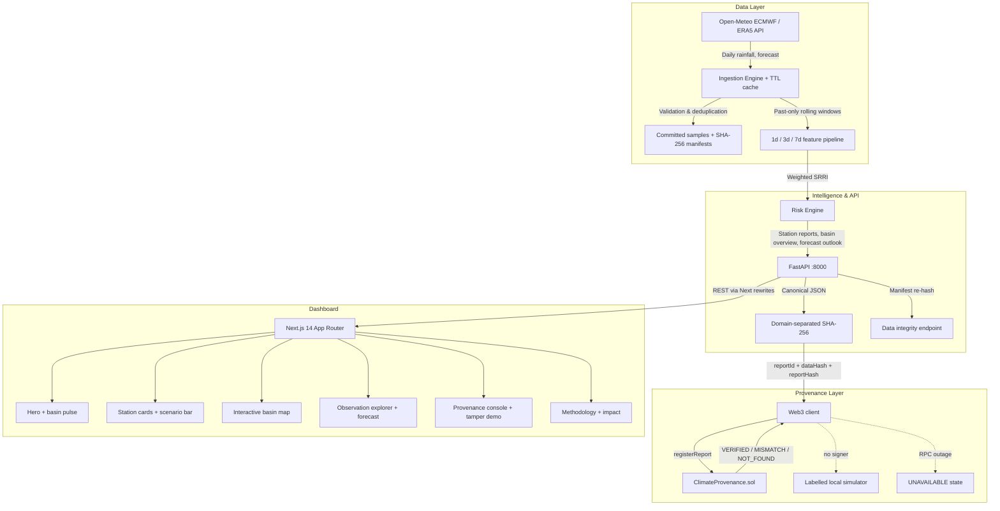

# ClimateChain BD — System Architecture

## 1. High-level architecture



---

## 2. Request lifecycle

### Live risk report
1. `GET /api/risk?location_id=sylhet-sadar`
2. Ingestion fetches the trailing 14 days (cache-first, 10-minute TTL).
3. `compute_rolling_precipitation` produces past-only 3d/7d sums.
4. `compute_rainfall_risk_indicator` applies the 50/30/20 weights and BMD-calibrated
   saturation thresholds.
5. `generate_risk_report` adds factor attribution, trend, data mode, and limitations.
6. The UI renders the gauge, metrics, factor bars, and provenance metadata.

### Historical scenario
- `GET /api/overview?as_of=2024-06-19&live=true`
- The same pipeline runs against the ERA5 archive for that date; four stations are fetched
  concurrently and cached for 5 minutes.
- Reports are labelled `HISTORICAL_REANALYSIS`; forecasts are intentionally disabled.

### Provenance
1. `POST /api/provenance/register` receives the canonical report.
2. The client derives a deterministic report ID, report hash, and data hash.
3. A real Sepolia transaction is submitted only when an RPC + contract + signer key are
   configured; otherwise a clearly labelled local simulator stores the record.
4. `POST /api/provenance/verify` recomputes the hash and returns one of five states.
   Registry reads never silently fall back to local data when a configured RPC fails.
5. The UI shows computed vs stored hashes and an audit trail from
   `GET /api/provenance/registry`.

---

## 3. Component breakdown

### Data layer (`ml/data/`)
- **Sources:** Open-Meteo archive and forecast APIs (ECMWF/ERA5).
- **Stations:** Sylhet Sadar, Sunamganj Sadar, Kanaighat, Zakiganj.
- **Validation:** positive-range checks, >500 mm flags, duplicate-date removal, null-safe
  fields for unverified gauges and flood labels.
- **Caching:** in-process TTL cache (`OPEN_METEO_CACHE_TTL`, default 600 s) so a dashboard
  load with four stations stays fast.
- **Honest fallback:** an upstream failure returns the committed sample with
  `data_quality = DEGRADED_OFFLINE_CACHE`; the UI and reports never present it as a fresh
  live observation.
- **Reproducibility:** `data/samples/*.json` plus `data/manifests/*.json` with SHA-256.
  Runtime reads never rewrite these files; only the seed script (`ml/data/seed_data.py`) passes `persist=True`.

### Risk engine (`ml/features.py`, `ml/inference.py`)
- **SRRI:** `0.50·acute + 0.30·subacute + 0.20·cumulative`, each component capped at 100.
- **Outputs:** score, risk level, severity label, factor contributions, summary, trend,
  station metadata, data quality/mode, limitations.
- **Overview:** concurrent four-station snapshots plus basin aggregate/ranking.
- **Forecast:** 7-day outlook using the same formula on forecast rainfall, tagged
  `FORECAST` and excluded from provenance.

### Provenance (`services/api/provenance/`)
- Canonical JSON: sorted keys, compact separators, float normalization to 4 decimals.
- Domain separation: `CLIMATECHAIN_BD_DATA_BATCH_V1:`,
  `CLIMATECHAIN_BD_PREDICTION_REPORT_V1:`, `CLIMATECHAIN_BD_REPORT_ID_V1:`.
- Contract: `ClimateProvenance.sol` stores `reportId`, `dataHash`, `reportHash`,
  `modelVersion`, `metadataUri`, `registeredAt`, `submitter`, and emits
  `ReportRegistered`.
- Verification: `VERIFIED`, `MISMATCH`, `NOT_FOUND`, `UNAVAILABLE`, `PENDING`.

### API (`services/api/main.py`)
- REST endpoints listed in the README.
- CORS via `FRONTEND_ORIGIN` or `ALLOW_ALL_ORIGINS=true`.
- Health endpoint exposes provenance mode, uptime, feature flags, and dependency status.
- Payload validation rejects incomplete reports before hashing.

### Web (`apps/web/`)
- Next.js 14 App Router, TypeScript, Tailwind CSS, Lucide icons.
- Central types (`src/lib/types.ts`), risk theme/formatting (`src/lib/risk.ts`), and a
  clearly labelled offline fallback (`src/lib/fallback.ts`).
- Components: hero, scenario bar, risk overview, station grid, basin map, observation
  explorer, forecast strip, provenance console, impact, methodology, footer.
- Accessibility: keyboard-selectable map markers, focus-visible rings, reduced-motion
  support, semantic headings, and skip link.

---

## 4. Deployment topology

```
Browser
  │
  ├─ Next.js 14 (port 3000 / Render $PORT)
  │    └─ /api/* rewrite → FastAPI (127.0.0.1:8000)
  │
  └─ FastAPI (uvicorn)
       ├─ Open-Meteo (ECMWF/ERA5)  [TTL cache]
       ├─ Committed samples + manifests
       └─ Sepolia RPC (optional) → ClimateProvenance.sol
```

The unified Dockerfile builds the frontend, installs Python dependencies, starts FastAPI
on an internal port, and runs Next.js on the public port. The Render blueprint uses the
same image with `ALLOW_ALL_ORIGINS=true` and optional provenance secrets.
