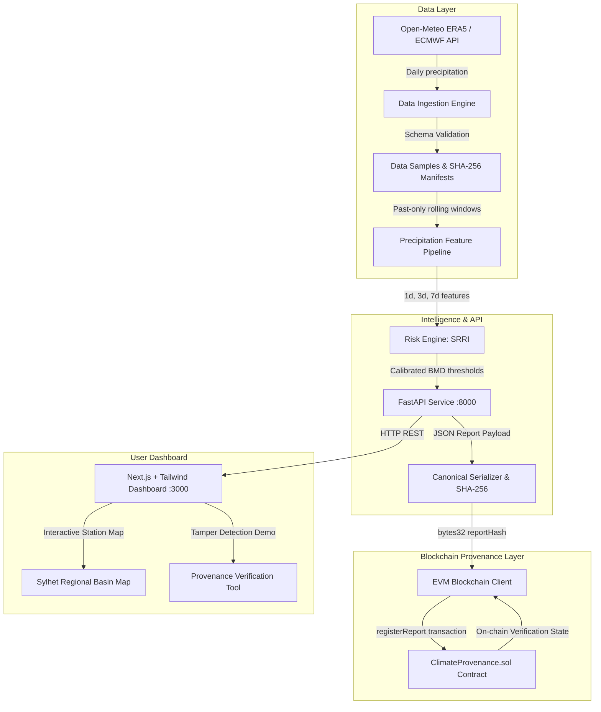

# ClimateChain BD — System Architecture

## 1. High-Level System Architecture

ClimateChain BD combines automated climate-data ingestion, hydrological rainfall risk assessment, and cryptographic blockchain provenance into an end-to-end verified environmental intelligence platform for the Sylhet / Surma River Basin in Bangladesh.

---

## 2. Component Breakdown

### 1. Data Layer (`ml/data/`)
- **Sources:** Live Open-Meteo Historical Archive and Forecast APIs querying ECMWF/ERA5 numerical models.
- **Stations:** Sylhet Sadar, Sunamganj Sadar, Kanaighat, and Zakiganj.
- **Integrity:** Strict range checks (0–1000 mm), deduplication by `(location_id, date)`, and past-only rolling feature extraction to prevent future-data leakage.
- **Manifests:** Stored in `data/manifests/` with SHA-256 digests and retrieval metadata.

### 2. Risk Engine & Feature Pipeline (`ml/features.py`, `ml/inference.py`)
- Computes the **Sylhet Rainfall Risk Index (SRRI)** from 24h acute rainfall ($R_{1d}$), 3-day catchment inflow ($R_{3d}$), and 7-day haor wetland saturation ($R_{7d}$).
- Calibrated to Bangladesh Meteorological Department (BMD) rainfall thresholds (Heavy: >44mm, Very Heavy: >88mm).
- Emits structured reports with explicit factor weights, limitations, and prototype disclaimers.

### 3. Canonicalization & Blockchain Client (`services/api/provenance/`)
- Domain-separated prefix hashing (`CLIMATECHAIN_BD_PREDICTION_REPORT_V1:` and `CLIMATECHAIN_BD_DATA_BATCH_V1:`).
- Deterministic JSON normalization: alphabetized keys, float normalization, and compact JSON serialization.
- Interacts with EVM Sepolia testnet or fallback local simulator.
- 5-state verification engine: `VERIFIED`, `MISMATCH`, `NOT_FOUND`, `UNAVAILABLE`, `PENDING`.

### 4. Smart Contract (`contracts/contracts/ClimateProvenance.sol`)
- Solidity `^0.8.24` deployed with 200 optimizer runs.
- Stores report commitments (`reportId`, `dataHash`, `reportHash`, `modelVersion`, `metadataUri`, `timestamp`, `submitter`).
- Rejects duplicates, zero hashes, and emits indexed `ReportRegistered` events.

### 5. Web Interface (`apps/web/`)
- Next.js 14 App Router with Tailwind CSS and Lucide icons.
- Interactive SVG map projecting real coordinates across the Surma and Kushiyara rivers.
- Interactive provenance verification tool featuring a live "Simulate Report Tampering" switch that proves hash-mismatch detection in real time.
